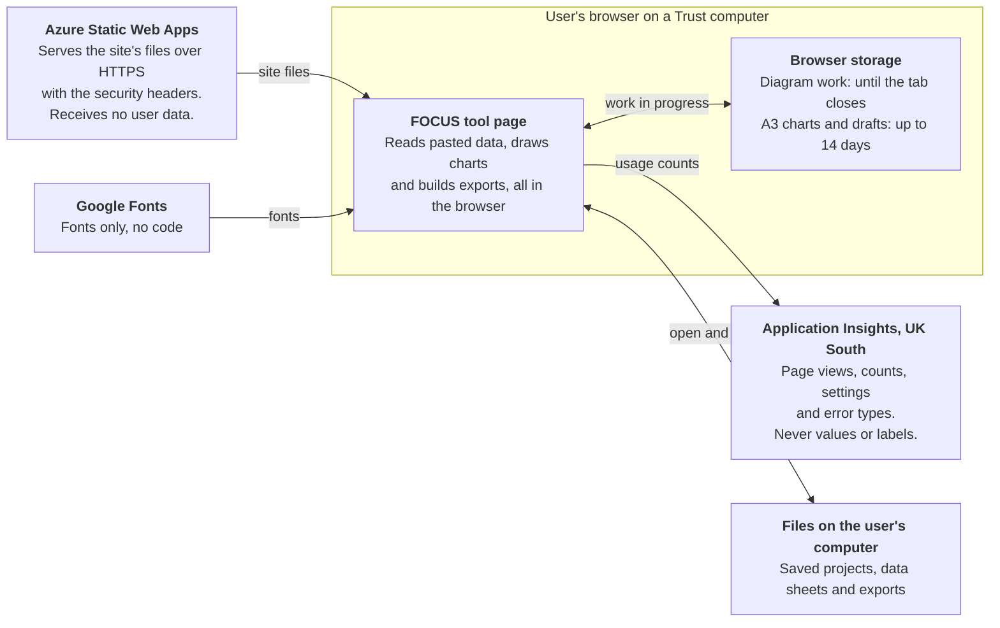

# FOCUS QI tools: OWASP ASVS Level 1 record

> **Draft, not yet signed off.** This record is being reviewed in a shared document. This copy is updated to match once it is approved. Keep it in step with the code: a pull request that changes anything in the review triggers below should update this file too.

Last updated 28 October 2026

## Purpose and scope

The FOCUS QI tools address the OWASP ASVS 5.0 Level 1 requirements that apply to them, with one change awaiting merge and four accepted risks. Most of ASVS does not apply, because the tools run entirely in the browser with no logins, server or database.

| Item | Detail |
| --- | --- |
| System | FOCUS QI tools: 29 tool and landing pages, built as a static Jekyll site |
| Hosting | Azure Static Web Apps, production at green-smoke-07bcedf03.3.azurestaticapps.net |
| Source | [PerrinShanks-Cogito/IntegratedQiTools](https://github.com/PerrinShanks-Cogito/IntegratedQiTools), `main` at commit 35b193f, plus [pull request #92](https://github.com/PerrinShanks-Cogito/IntegratedQiTools/pull/92) |
| Standard | OWASP Application Security Verification Standard (ASVS) 5.0, Level 1 |
| Assessed | 28 October 2026 |
| Assessed by | Code review and testing with Claude Code, checked on the live site by \[name, role\] |
| Approved by | \[name, role\] |

## How the system works

Nothing a person pastes or types leaves their browser: the only data sent out is usage counts to Application Insights.

Azure serves the site's files and receives nothing back. Work in progress is kept in the browser for a limited time, and anything kept longer is a file the person saves themselves. The security policy lets data go only to the site and Application Insights.

## Assessment by ASVS chapter

Nine of the 17 chapters apply in full or in part. Of those, seven are met and two are met once pull request #92 (file size limits and error reports) is merged.

| Chapter | Applies | Status | Evidence and notes |
| --- | --- | --- | --- |
| V1 Encoding and Sanitization | Yes | Met | Text people type or paste is escaped before it is put into the page. No `eval`, `new Function` or string timers. The injection test found nothing on any page. |
| V2 Validation and Business Logic | In part | Met | Pasted data is checked in the browser, for example a count can't be more than its total. There is no server-side logic to bypass. |
| V3 Web Frontend Security | Yes | Met | Content Security Policy allows scripts only from the site (`script-src 'self' 'wasm-unsafe-eval'`), with `object-src 'none'`, `base-uri 'none'` and `frame-ancestors 'self'`. Also `X-Content-Type-Options: nosniff`, `X-Frame-Options: SAMEORIGIN` and `Referrer-Policy: strict-origin-when-cross-origin`. No third-party scripts. |
| V4 API and Web Service | No | Not applicable | Static files only; no APIs. |
| V5 File Handling | In part | Met once #92 is merged | Project files (.json) and data sheets (.xlsx) are opened in the browser only, never uploaded or stored. Size limits: 50 MB for project files, 10 MB for data sheets, 25 MB for A3 pictures, and 100 MB unzipped for each part of a data sheet (#92). |
| V6 Authentication | No | Not applicable | No accounts or logins. Imprivata single sign-on runs as a browser extension, outside the site. |
| V7 Session Management | No | Not applicable | No sessions or cookies. |
| V8 Authorization | No | Not applicable | No users, roles or protected data on the server. |
| V9 Self-contained Tokens | No | Not applicable | No tokens. |
| V10 OAuth and OIDC | No | Not applicable | No OAuth or OpenID Connect. |
| V11 Cryptography | No | Not applicable | The site does no cryptography of its own. |
| V12 Secure Communication | Yes | Met | Served over HTTPS only by Azure. `Strict-Transport-Security: max-age=31536000; includeSubDomains`, confirmed on the live site. |
| V13 Configuration | Yes | Met | Security settings are in `staticwebapp.config.json`, in source control. No secrets in the repository; the Application Insights connection string only allows sending data, so it is public by design. |
| V14 Data Protection | Yes | Met | Pasted data never leaves the browser. Analytics send counts and fixed settings only, never values, labels or notes. Diagram autosave lasts only while the tab is open. A3 report charts and drafts are cleared after 14 days (#91). |
| V15 Secure Coding and Architecture | Yes | Met | Third-party parts are listed: the Application Insights SDK 3.4.5, self-hosted and loaded with an integrity hash, and Google Fonts. Build dependencies are pinned in `Gemfile.lock`. |
| V16 Security Logging and Error Handling | In part | Met once #92 is merged | No server, so no server-side logs beyond the Azure platform's own. Browser error reports carry only the error type and where in the code it happened, never the message (#92). |
| V17 WebRTC | No | Not applicable | No WebRTC. |

## Tests carried out

Every test passed, all on 28 October 2026. The live headers, live analytics and Imprivata checks were made on the live site; the rest ran on a local build served with the live site's security headers.

| Test | What was done | Result |
| --- | --- | --- |
| Script injection | A script payload was put into every text box and data field on all 29 pages, after loading each tool's example | No payload ran on any page |
| Control test | A script was injected into a page on purpose | Blocked and reported by the security policy |
| Pages and exports under the policy | Every page loaded, its example run and every export used, with the strict policy in force | No errors or blocked scripts on any page |
| Analytics SDK integrity | The self-hosted file's SHA-384 hash compared with Microsoft's published `ai.3.4.5.integrity.json` | Hashes match |
| Live security headers | Response headers checked in the browser on the live site | `Strict-Transport-Security` and the strict `Content-Security-Policy` present |
| Live analytics | Network requests checked on the live site | Sent only to the UK South Application Insights service, status 200 |
| Imprivata sign-on | A tool opened on a Trust computer with Imprivata, under the strict policy | Sign-on completed with no policy errors |
| Diagram autosave | Work saved by the old version reloaded, then a new tab opened | Work moved across once and was deleted from long-term storage; a new tab starts empty |
| A3 report clearing (#91) | A chart and draft aged to 15 days and another chart to 13 days, then an unrelated tool opened | The 15-day items were cleared and the 13-day chart kept; an undated older draft was dated, not deleted |

## Accepted risks

Four risks are accepted because the fix would cost more than the risk, or would break something the Trust needs.

| Risk | Why it is accepted | Impact |
| --- | --- | --- |
| The policy still allows inline styles (`style-src 'unsafe-inline'`) | Removing it means rewriting hundreds of `style=` attributes. Inline styles can't run code, and scripts stay blocked. | Low |
| The policy allows WebAssembly (`'wasm-unsafe-eval'`) | Imprivata single sign-on runs WebAssembly in the page and fails without it. It does not allow `eval`. | Low |
| Google Fonts load from Google with no integrity check | A stylesheet that Google changes can't carry a fixed hash. Fonts can't run code, and the policy limits them to Google's font servers. | Low |
| Stored work stays in the browser until a FOCUS tool is next opened | Browser storage can't clear itself. Diagram work clears when the tab closes, and A3 items more than 14 days old are cleared at the next visit. | Low |

## Open actions, review and sign-off

Merging #92 closes the last gap; after that, the record is reviewed whenever the site changes in a way that touches security.

- [x] Merge [pull request #91](https://github.com/PerrinShanks-Cogito/IntegratedQiTools/pull/91): clears A3 report charts and drafts after 14 days (V14)
- [ ] Merge [pull request #92](https://github.com/PerrinShanks-Cogito/IntegratedQiTools/pull/92): size limits of 50 MB for project files, 10 MB for data sheets and 25 MB for A3 pictures (V5), and error reports that send only the error type (V16)
- [ ] Check for Application Insights SDK updates once a year, and update the pinned copy using the steps in `assets/js/analytics.js` (V15)

Review this record when any of these happens, and at least once a year:

- A new tool or page is added
- A new outside script, font, image source or API is used
- `staticwebapp.config.json` changes
- The way the tools store or send data changes

| Sign-off | Name | Role | Date |
| --- | --- | --- | --- |
| Assessed by | \[name\] | \[role\] | \[date\] |
| Approved by | \[name\] | \[role\] | \[date\] |
| Next review due | | | \[date\] |
